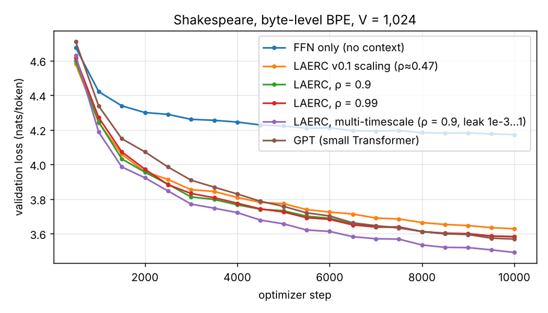
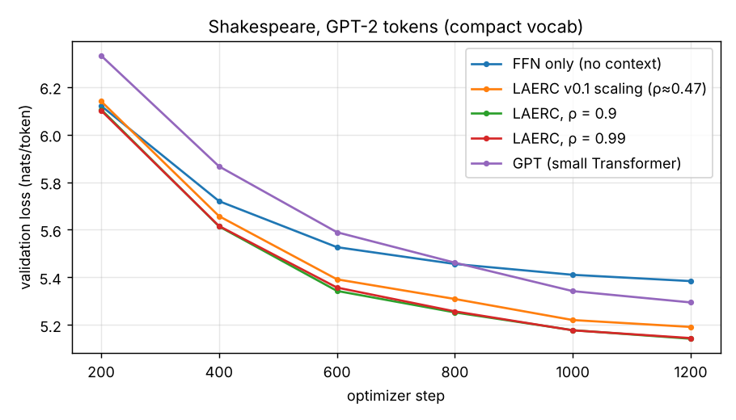

# LAERC – Layered Attention-Enhanced Reservoir Language Model

LAERC is a small PyTorch language model built from **frozen random reservoirs** and a learned, **content-dependent readout**. There are no self-attention layers. Each layer instead has:
- a fixed random recurrent network (the reservoir) that carries the context
- a learned MLP and gate that decide, token by token, *what* to take from the reservoir state

That readout is the "attention": the model attends to features of a high-dimensional, fading memory of the past, not to individual past tokens.

The repo has a `laerc` package (model, training with validation and resuming, memmapped data) and scripts to:
- tokenize text with the GPT-2 tokenizer
- train
- sample with carried reservoir state
- benchmark against simple baselines

## The model

Each of the *L* blocks maps the residual stream $x_t \in \mathbb{R}^D$ to a new one:

$$
\begin{aligned}
h_t &= \tanh\!\big(U\,\mathrm{LN}(x_t) + W h_{t-1}\big) && \text{frozen reservoir, } h_t\in\mathbb{R}^{R},\ R = 4D \\
r_t &= e^{s}\,\mathrm{MLP}\big(\mathrm{LN}(h_t)\big) && \text{learned readout of the reservoir state} \\
g_t &= \sigma\big(\mathrm{MLP}(\mathrm{LN}([x_t, r_t]))\big) && \text{content-dependent gate} \\
m_t &= g_t \odot r_t + (1-g_t)\odot x_t \\
y_t &= m_t + \alpha\,\mathrm{FFN}(\mathrm{LN}(m_t)) && \alpha \text{ initialised at 0 (ReZero)}
\end{aligned}
$$

Only $U$ and $W$ are random and frozen. $W$ is scaled to **spectral radius** ρ, which sets how long the reservoir remembers: a perturbation decays like $\rho^t$, so the memory timescale is about $1/\ln(1/\rho)$ tokens. That is roughly 10 tokens at ρ = 0.9 and 100 at ρ = 0.99. Embedding and output weights are tied.

### Multi-timescale reservoir (`--res_leak_min`)

With a single ρ every reservoir unit forgets at about the same rate, so the whole state is spent on one timescale. The leaky variant gives each unit $i$ its own leak rate $a_i$, log-spaced from `res_leak_min` to 1:

$$
h_t = (1-a)\odot h_{t-1} + a \odot \tanh\!\big(U\,\mathrm{LN}(x_t) + W h_{t-1}\big), \qquad a_i \in [a_{\min},\,1]\ \text{log-spaced}
$$

Units with $a\approx 1$ behave like the plain reservoir and keep the last few tokens precisely; units with $a \ll 1$ are near-linear running averages with timescale $\tau\approx 1/a$ that summarise the wider context. Every decade of $\tau$ gets the same number of units. $U$ and $W$ stay frozen and random, and the number of trainable parameters does not change. The recurrence then runs as a Python loop instead of the fused `nn.RNN` kernel, which makes training about 1.8× slower on CPU.

### Geometric depth schedule (`--res_depth_growth`)

Stacking reservoirs makes deeper layers see further back, but only additively. Linearise block $k$ around its operating point as a leaky filter with impulse response $g(t)\propto e^{-t/\tau}$. Each block filters the output of the block below, so the kernels convolve, and block $L$ responds to a token from $t$ steps ago with a gamma kernel:

$$
g_L(t) \;\propto\; t^{\,L-1} e^{-t/\tau}, \qquad \langle t\rangle = L\tau,\quad \sigma_t = \sqrt{L}\,\tau .
$$

So $L$ identical blocks reach about $L\tau$ tokens (500 → 1000 → 1500 …). Block $L$ also mostly holds a band around $L\tau$ rather than everything up to it, while the residual stream keeps the recent tokens. Reaching a context of $T$ tokens this way needs depth that grows linearly in $T$.

`--res_depth_growth g` makes the timescales grow geometrically with depth instead. Block $k$'s leak rates are divided by $g^k$:

$$
a^{(k)}_i = g^{-k}\, a_i, \qquad \tau^{(k)} \in \big[\,g^{k},\; g^{k}/a_{\min}\big]\ \text{tokens},
$$

so the last block reaches about $g^{L-1}/a_{\min}$ tokens, and a context of $T$ needs only $L \approx \log_g T$ blocks. This is the idea behind Clockwork RNNs and dilated convolutions, and, taken to its limit, scale-invariant memories such as HiPPO-LegS and Legendre Memory Units. It combines with `--res_leak_min`: each block keeps its own band of $\log_{10}(1/a_{\min})$ decades, and $g$ shifts that band further back from block to block. Choosing $g \approx 1/a_{\min}$ makes the bands tile without gaps, for example `--res_leak_min 0.1 --res_depth_growth 10`. With `--res_leak_min 1` each block has a single timescale $g^k$, and block 0 stays the fused plain reservoir. Training prints the timescale band of every block, and the default $g = 1$ leaves the model exactly as before.

The effect, measured in a test: perturb the first of 150 tokens in an untrained 4-block model and look at each block's reservoir state at the end.

| block | 0 | 1 | 2 | 3 |
|---|---|---|---|---|
| $g = 1$ (plain stack) | 2e-7 | 8e-7 | 1e-6 | 1e-6 |
| $g = 4$ (τ = 1, 4, 16, 64) | 2e-7 | 3e-7 | 5e-3 | 7e-2 |

This makes the *horizon* long, not the *recall* exact. Each block still has a fixed state size $R$, and an echo-state network's linear memory capacity is bounded, $\sum_k \mathrm{MC}_k \le R$. So the further back the context, the coarser the summary: the resolution falls off roughly like $1/t$. Gist and topic survive, but copying an exact token from 50k tokens ago does not. That needs a state that grows with context, such as a KV cache, or a retrieval side channel.

Since everything except the reservoir acts on one token at a time, the model can generate **incrementally**. `sample.py` carries each block's reservoir state forward, so every new token costs one step instead of a pass over the whole sequence (15× faster for 500 tokens on CPU). Feeding a sequence in pieces gives exactly the same logits as feeding it at once, and a test checks this.

## Results: Shakespeare, ~200k parameters, 1,024-token BPE

Setup:
- complete works, byte-level BPE with 1,024 tokens trained on the training split (2.4 characters per token)
- D = 48, L = 4, sequence length 128, batch 16, so about 200k trainable parameters *including* the embedding
- 10,000 steps at lr 3e-3, one seed, CPU
- validation on fixed windows of the held-out last 1%; **bits per character** (bpc) is comparable across tokenizers

Reproduce with:

```bash
python scripts/prepare_bpe_tokens.py --raw_dir data/raw --out_dir data/shakespeare_bpe1024 --vocab_size 1024
python benchmarks/run_benchmark.py --data_dir data/shakespeare_bpe1024 --emb 48 --steps 10000 --eval_interval 500 \
    --out results/shakespeare_bpe1024
```

| model | trainable params (all) | non-embedding | best val loss | val perplexity | bits/char |
|---|---|---|---|---|---|
| FFN only (no context) | 153,508 | 104,356 | 4.172 | 64.9 | 2.496 |
| LAERC v0.1 scaling (ρ≈0.47) | 201,512 | 152,360 | 3.628 | 37.6 | 2.171 |
| LAERC, ρ = 0.9 | 201,512 | 152,360 | 3.582 | 35.9 | 2.143 |
| LAERC, ρ = 0.99 | 201,512 | 152,360 | 3.583 | 36.0 | 2.144 |
| **LAERC, multi-timescale** (ρ = 0.9, leak 10⁻³…1) | 201,512 | 152,360 | **3.491** | **32.8** | **2.089** |
| GPT, same width and depth | 168,480 | 119,328 | 3.568 | 35.5 | 2.135 |



- **The multi-timescale reservoir is the best model here:** 2.089 bpc against 2.135 for the GPT and 2.143 for the single-ρ reservoir. It adds 15% to the context gain over the FFN-only model (0.407 vs. 0.353 bpc) and is ahead of every other model at every evaluation from step 1,000 on.
- **Longer memory alone does nothing:** ρ = 0.9 and ρ = 0.99 are identical, and even ρ ≈ 0.47 (about one token of memory) gets most of the way. A plausible reason is capacity: a reservoir with $R$ units holds at most about $R$ dimensions of linearly recoverable history (Jaeger's memory-capacity bound), which with a $D$-dimensional input is only $R/D = 4$ tokens. Raising ρ shifts that budget to older tokens at the expense of recent ones; spreading the leak rates instead divides it over $\log\tau$.
- **The single-ρ LAERC and the GPT are tied** (2.143 vs. 2.135 bpc), and the GPT has 17% fewer parameters.
- **This 200k model beats the 1.56M-parameter one below:** about 2.09–2.14 bpc here against about 2.16 bpc (5.142 nats/token at 3.44 characters per token) for the 20k-vocabulary run, though that run had only 1,200 steps.

Caveats: one seed, the LAERC models have about 20% more trainable parameters than the GPT, and with a 128-token window the slowest units ($\tau \approx 1000$) never reach a steady state. The next checks are more seeds, a parameter-matched GPT and longer sequences.

## Results: Shakespeare, GPT-2 vocabulary (v0.2)

Setup:
- complete works (2.7M GPT-2 tokens), compact vocabulary of 20,204 tokens
- D = 64, L = 4, sequence length 128, batch 16
- 1,200 steps at lr 3e-3, one seed, 2 CPU cores, about 9 minutes per model
- validation loss on fixed windows of the held-out last 1%

Reproduce with `python benchmarks/run_benchmark.py --data_dir data/shakespeare_compact`.

| model | trainable non-embedding params (the tied 20,204 × 64 embedding adds 1.29M) | best val loss | val perplexity |
|---|---|---|---|
| FFN only, `--no_reservoir` (no information flows between tokens) | 184k | 5.384 | 217.9 |
| LAERC, v0.1 reservoir scaling (actual ρ ≈ 0.47) | 269k | 5.191 | 179.7 |
| **LAERC, ρ = 0.9** | 269k | **5.142** | **171.0** |
| LAERC, ρ = 0.99 | 269k | 5.145 | 171.5 |
| GPT, same width and depth (4 heads, learned positions) | 208k | 5.295 | 199.2 |



- **The reservoirs carry real context.** Going from the context-free FFN to LAERC lowers perplexity from 218 to 171, a 22% reduction.
- **The spectral-radius fix helps:** perplexity drops from 180 to 171. Between ρ = 0.9 and ρ = 0.99 there is no difference at this budget.
- **On this short CPU budget, LAERC beats a small GPT of the same width and depth.** Two caveats: the GPT has about 22% fewer trainable parameters, and its curve is still falling faster at the end. So this is a statement about sample efficiency early in training, not about which architecture wins at scale.

Sample from the ρ = 0.9 model (`--prompt "ROMEO:" --top_p 0.9 --temperature 0.9`):

```text
ROMEO:
[He exits.]

Scene 4
=====

SceneUD  What was all, the people of a world
To see it well to hear thee not.

DUKE, [aside]
Nose man's body, we do in the Duke of the
somes a pertbroius, and the Lord of France.
```

## Installation

```bash
git clone https://github.com/fekoester/LAERC.git && cd LAERC
python3 -m venv .venv && source .venv/bin/activate
pip install --upgrade pip
pip install -e .                      # add ".[openwebtext]" for OpenWebText, ".[dev]" for tests
```

For a CPU-only machine, run `pip install torch --index-url https://download.pytorch.org/whl/cpu` first, which is a much smaller download.

## Quick start: Shakespeare

```bash
mkdir -p data/raw
curl -L https://raw.githubusercontent.com/fekoester/Shakespeare_Res/main/data/shakespeare.txt -o data/raw/shakespeare.txt

# tokenize (GPT-2 BPE); --compact_vocab keeps only the ~20k tokens that occur -> 2.5x smaller output layer
python scripts/prepare_gpt2_tokens.py --dataset custom --raw_dir data/raw \
    --out_dir data/shakespeare_compact --val_fraction 0.01 --compact_vocab

# train (validation loss every 500 steps, best.pt kept)
python scripts/train_openwebtext.py --data_dir data/shakespeare_compact \
    --seq 128 --emb 64 --layers 4 --batch 32 --epochs 10 --steps_per_epoch 1000 --lr 3e-3

# sample (best.pt in the run directory, carried reservoir state)
python scripts/sample.py --ckpt_dir checkpoints/laerc_v20204_seq128_d64_L4_R4_RMLP1_FF4 \
    --prompt "ROMEO:" --max_tokens 200 --top_p 0.9 --temperature 0.9
```

For a much smaller model, train a 1,024-token BPE on the text instead of using GPT-2 tokens. The tokenizer is stored in `meta.json` and inside every checkpoint, so `sample.py` decodes it without extra files:

```bash
python scripts/prepare_bpe_tokens.py --raw_dir data/raw --out_dir data/shakespeare_bpe1024 --vocab_size 1024
python scripts/train_openwebtext.py --data_dir data/shakespeare_bpe1024 \
    --seq 128 --emb 48 --layers 4 --batch 16 --epochs 10 --steps_per_epoch 1000 --lr 3e-3 --res_leak_min 1e-3
```

The vocabulary size is read from the dataset's `meta.json`, so `--vocab` doesn't need to be set. The id map travels inside each checkpoint, and `sample.py` uses it to decode compact ids.

A run directory contains:

| file | content |
|---|---|
| `model_step<N>.pt` | checkpoint at the end of each epoch (model, optimizer, scheduler, RNG) |
| `best.pt` | checkpoint with the lowest validation loss |
| `loss_log.csv` | training loss every `--log_interval_steps` |
| `val_log.csv` | validation loss and perplexity every `--eval_interval_steps` |

Continue a run with `--resume path/to/model_stepN.pt`.

## OpenWebText

```bash
python scripts/prepare_gpt2_tokens.py --dataset openwebtext --out_dir data/openwebtext_tokens \
    --val_fraction 0.01 --max_docs 100000
python scripts/train_openwebtext.py --data_dir data/openwebtext_tokens --seq 128 --emb 64 --layers 8 \
    --batch 64 --epochs 5 --steps_per_epoch 2000 --amp      # --amp: bf16 autocast on CUDA
```

Tokens are streamed to disk, so 100k documents (about 113M tokens) need little RAM. Documents are separated by GPT-2's end-of-text token.

## Options

`scripts/train_openwebtext.py --help` lists everything. The main options:

| group | flags |
|---|---|
| data | `--data_dir`, `--seq`, `--vocab` (taken from `meta.json` when present) |
| model | `--emb`, `--layers`, `--resv_mult` (R = mult·D), `--res_mlp_mult`, `--ffn_mult`, `--res_radius`, `--res_scale {radius,norm}`, `--res_leak_min` (< 1: multi-timescale), `--res_depth_growth` (> 1: geometric depth schedule), `--no_reservoir` |
| optimization | `--batch`, `--accum`, `--lr`, `--weight_decay`, `--grad_clip`, `--beta2`, `--epochs`, `--steps_per_epoch` |
| schedule | `--no_sched`, `--warmup_frac`, `--hold_frac`, `--min_lr_ratio` |
| evaluation | `--eval_interval_steps`, `--eval_batches`, `--resume` |
| hardware | `--amp` (bf16 on CUDA), `--compile` |

Sampling options are `--temperature`, `--top_k`, `--top_p`, `--seed` and `--num_samples`.

## Changes in 0.4

- **New: geometric depth schedule.** `--res_depth_growth g` multiplies block *k*'s reservoir timescales by $g^k$, so depth grows like $\log T$ instead of $T$. It is off by default ($g = 1$), and checkpoints that lack the key load unchanged. Training prints the per-block timescales. The benchmark has a `laerc_depth` run (leak 0.1…1, $g = 4$), which isn't in the results table yet.
- Run names include `leak…` and `G…` when those options are set, so runs with different options no longer share a checkpoint directory.

## Changes in 0.3

- **New: multi-timescale reservoir.** `--res_leak_min` gives each reservoir unit its own leak rate, log-spaced up to 1. U and W stay frozen. It is the best model in the 200k-parameter benchmark above. Feeding a sequence in pieces still gives exactly the same logits, and a test checks this.
- **New: `scripts/prepare_bpe_tokens.py`** trains a small byte-level BPE (e.g. 1,024 tokens) on the training text. The tokenizer travels in `meta.json` and in the checkpoints. The output layer and embedding shrink by 20×.
- **New in the benchmark:** bits per character (comparable across tokenizers), total trainable parameters, a `laerc_multi` run and a plot title that names the tokenizer.
- `tokenizers` is now a dependency, and benchmark checkpoints (`results/*/ckpt/`) are git-ignored.

## Changes in 0.2

- **Fixed: the reservoir's spectral radius.** v0.1 scaled the *spectral norm* to 0.9, which for a random Gaussian matrix leaves a spectral radius of only about 0.47 (memory of about 1.3 tokens). The radius is now scaled exactly. `--res_scale norm` reproduces v0.1, and a test checks this against the original code.
- **Fixed: validation.** `val.bin` was never evaluated. There is now validation loss and perplexity during training, `best.pt` and `--resume`.
- **Fixed: `--beta2` was ignored.**
- **Fixed: checkpoints from `--compile` couldn't be loaded** because of the `_orig_mod.` prefix. Both old and new checkpoints now load.
- **Fixed: data preparation** now separates documents with end-of-text tokens and streams to disk instead of building one Python list.
- **New:**
  - incremental generation with carried reservoir state, plus top-p sampling
  - `--compact_vocab`
  - bf16 autocast on CUDA
  - `tiktoken` added to the requirements
- **New:** pyproject, a benchmark against an FFN-only model and a small GPT, tests and CI.
